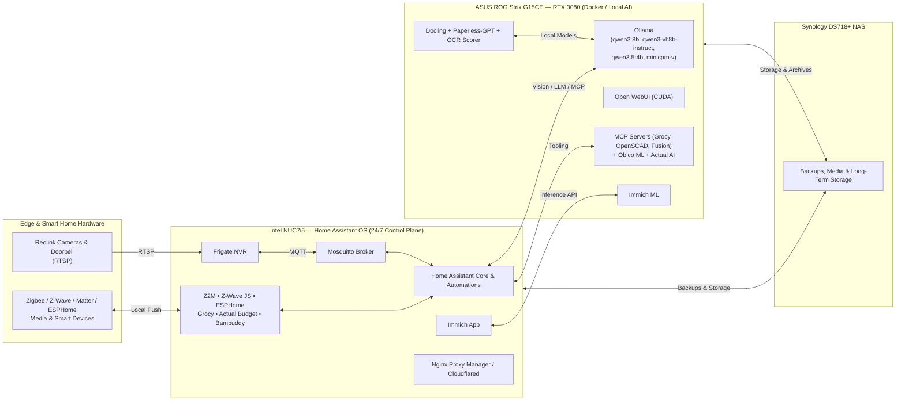

# Local-First AI Homelab & Home Automation

A local-first smart home, self-hosted services, and AI inference architecture built with **extreme frugality**, **strong data safety and security**, and **high availability** across existing hardware.

Rather than paying recurring monthly fees for cloud AI APIs, smart home subscriptions, or managed SaaS tools, this setup maximizes existing compute and storage—pairing a dedicated **Intel NUC7i5 (Home Assistant OS)** control plane, an **ASUS ROG Strix G15CE (RTX 3080)** GPU compute node, and a **Synology DS718+ NAS**—to keep data private, resilient, and fast.

---

## Core Objectives

1. **Local-First & Zero Recurring SaaS Overhead:** Run core automations, voice/vision AI, document intelligence, photo management, budgeting, and household inventory locally so recurring cloud costs stay near zero.
2. **Extreme Frugality & Hardware Reuse:** Repurpose existing desktop GPU hardware (`RTX 3080`), mini-PC/NUC compute (`Intel NUC7i5`), and network storage (`Synology DS718+`) instead of buying new appliances or paying ongoing cloud token/subscription fees.
3. **Data Safety & Security:** Keep sensitive family photos, financial/household records, camera feeds, and AI prompts inside your own network boundary, backed by strict secret hygiene and controlled remote access.
4. **Readily Available (High Availability & Resilience):** Keep essential home controls running 24/7 on low-power hardware, back up data reliably, and design graceful fallbacks when GPU workloads or secondary services are busy or offline.

---

## High-Level Architecture



---

## How the Four Pillars Work in Practice

* **Frugal Compute Allocation:** Lightweight, always-on home state and device bridges stay on the low-power NUC7i5, while heavy vision, OCR, and LLM tasks run on-demand on the RTX 3080 workstation.
* **Security & Privacy Boundaries:** Secrets, tokens, local hostnames, and network details are isolated from code and documentation; external access is routed intentionally rather than exposing raw internal services.
* **Readily Available Data & Controls:** Core automations rely on local protocols (MQTT, Zigbee, Z-Wave, ESPHome, local camera streams) so lights, sensors, and security alerts work even if external internet links degrade, while NAS storage and backups protect critical data.
* **Graceful Degradation:** AI-enhanced features (such as VLM camera summaries or document/ML pipelines) are layered on top of reliable baseline automations so a busy or offline GPU node never breaks core home functions.

---

## Repository Layout

```text
.
├── README.md                        # Vision, objectives, and architecture overview
├── .gitignore                       # Prevents committing secrets, env files, and local artifacts
├── .env.example                     # Template for non-secret endpoints and ports
├── docs/
│   ├── architecture.md              # Detailed node roles and data flows
│   ├── inventory.md                 # Home Assistant apps, integrations, and Docker containers
│   └── runbooks.md                  # VRAM management, service hygiene, and recovery notes
├── home-assistant/
│   ├── packages/                    # Modular Home Assistant YAML packages
│   └── secrets.yaml.example         # Placeholder structure for local secrets
├── docker-pc/
│   └── compose.example.yml          # Reference container layout for local AI & tooling
└── .github/
    └── workflows/
        └── lint.yml                 # Automated validation checks
```

---

## Getting Started Safely

1. Copy `.env.example` to `.env` and `home-assistant/secrets.yaml.example` to `home-assistant/secrets.yaml` (both ignored by Git).
2. Fill in your local service URLs, API keys, and tokens only in untracked local files.
3. Review `docs/architecture.md`, `docs/inventory.md`, and `docs/runbooks.md` to adapt the patterns to your own hardware and security posture.